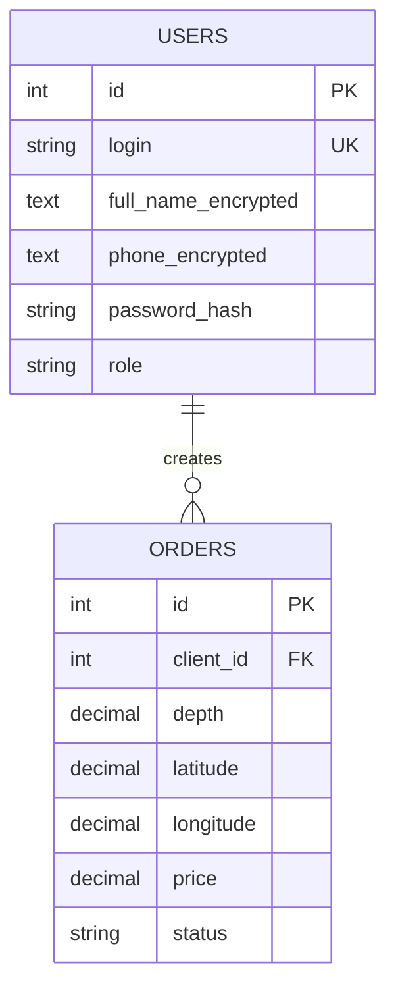

# ГеоБур — система управления заявками на бурение

Учебный проект по безопасной разработке веб-приложений. Система позволяет клиенту рассчитать стоимость бурения и отправить заявку с координатами, сотруднику — просматривать заявки на карте и обновлять их статус, администратору — управлять ролями пользователей.

> Проект создан для курсовой работы и портфолио. Перед реальным публичным запуском требуется production-настройка HTTPS, секретов, ограничений входа, миграций базы данных и мониторинга.

## Возможности

### Клиент

- регистрация с ФИО, телефоном, логином и паролем;
- вход в личный кабинет;
- серверный расчёт предварительной сметы по глубине;
- создание заявки с широтой и долготой;
- просмотр своих заявок и их текущего статуса.

Тарифы задаются в серверном коде `app.py` и не принимаются от браузера:

| Услуга | Тариф |
| --- | ---: |
| Бурение | 2 500 ₽/м |
| Обсадная труба | 900 ₽/м |
| Дополнительные работы | 50 000 ₽ |

Формула сметы: `глубина × 2 500 + глубина × 900 + 50 000`.

### Сотрудник

- карта заявок на основе координат из PostgreSQL;
- метка показывает данные заявки и клиента;
- зелёная метка означает выполненную заявку, оранжевая — остальные статусы;
- сотрудник может менять статус: «Зарегистрирована», «В работе», «Выполнена».

Карта отображается с помощью Leaflet и тайлов OpenStreetMap. Для её загрузки браузеру нужен интернет. Координаты клиент вводит вручную; геокодирование адресов в проекте пока не реализовано.

### Администратор

- просмотр списка зарегистрированных пользователей;
- просмотр ФИО, телефона, логина и текущей роли;
- назначение ролей `client`, `employee` и `admin`;
- доступ к кабинету клиента и карте заявок;
- собственную роль администратор изменить не может.

Регистрация через публичную форму создаёт пользователя с ролью `client`. Первого администратора нужно назначить вручную в базе данных — инструкция приведена ниже.

## Технологии

- Python 3
- Flask
- PostgreSQL
- Flask-SQLAlchemy и SQLAlchemy
- Flask-Login
- Flask-Bcrypt
- Flask-WTF / CSRFProtect
- cryptography (Fernet)
- python-dotenv
- HTML, CSS и JavaScript
- Leaflet и OpenStreetMap

## Структура проекта

```text
kursovaya_3sem/
├── app.py                    # Маршруты, авторизация, сметы, заявки и роли
├── config.py                 # Конфигурация Flask и параметры cookies
├── models.py                 # Модели User и Order
├── security.py               # Шифрование и расшифровка Fernet
├── requirements.txt          # Python-зависимости
├── .env.example              # Образец локальной конфигурации без секретов
├── docs/
│   ├── database.txt           # Описание таблиц
│   └── roles.txt              # Роли и матрица доступа
└── templates/
    ├── main.html              # Главная и регистрация
    ├── login.html             # Вход
    ├── client.html            # Кабинет клиента и калькулятор
    ├── employee_map.html      # Карта и управление статусами
    └── admin.html             # Управление пользователями и ролями
```

## Схема данных



Допустимые значения роли: `client`, `employee`, `admin`. Статусы заявки хранятся как `registered`, `in_progress`, `completed`; в интерфейсе показываются русские названия.

## Локальный запуск

### 1. Требования

- Python 3.10 или новее;
- PostgreSQL;
- Git (если проект клонируется из репозитория).

### 2. Установить зависимости

В PowerShell из папки проекта:

```powershell
py -m venv .venv
.\.venv\Scripts\Activate.ps1
py -m pip install --upgrade pip
py -m pip install -r requirements.txt
```

Если PowerShell запрещает активацию окружения, можно выполнить `\.venv\Scripts\python.exe -m pip install -r requirements.txt` и далее запускать приложение через `\.venv\Scripts\python.exe app.py`.

### 3. Создать базу данных PostgreSQL

Создайте пустую базу, например `geobur`. Затем скопируйте `.env.example` в `.env` и укажите параметры своей базы и секретные ключи.

Сгенерировать ключ Fernet можно командой:

```powershell
py -c "from cryptography.fernet import Fernet; print(Fernet.generate_key().decode())"
```

Для `FLASK_SECRET_KEY` используйте длинное случайное значение. Не публикуйте `.env` и не отправляйте его в GitHub.

### 4. Запустить приложение

```powershell
py app.py
```

Откройте `http://127.0.0.1:5000`. При запуске `app.py` создаёт отсутствующие таблицы и добавляет колонку `status` в существующую таблицу `orders`, если её ещё нет. Для изменения схемы в дальнейшем рекомендуется перейти на инструмент миграций, например Flask-Migrate/Alembic.

### 5. Назначить первого администратора

1. Зарегистрируйте аккаунт через главную страницу.
2. В pgAdmin откройте Query Tool для базы проекта и выполните запрос, заменив значение на логин этого аккаунта:

```sql
UPDATE users
SET role = 'admin'
WHERE login = 'your_login';
```

3. Перезапустите Flask и войдите в аккаунт. Администратор попадёт на страницу `/admin`.

## Основные адреса приложения

| Путь | Назначение | Доступ |
| --- | --- | --- |
| `/` | Главная и регистрация | Публичный |
| `/register` | Обработка регистрации | Публичный |
| `/login` | Вход | Публичный |
| `/client` | Расчёт, создание и просмотр заявок | Клиент, администратор |
| `/orders/create` | Сохранение заявки | Клиент, администратор; POST |
| `/employee/map` | Карта всех заявок и данные клиентов | Сотрудник, администратор |
| `/employee/orders/<id>/status` | Изменение статуса заявки | Сотрудник, администратор; POST |
| `/admin` | Список пользователей и управление ролями | Администратор |
| `/admin/users/<id>/role` | Назначение роли | Администратор; POST |
| `/logout` | Выход | Авторизованный пользователь; POST |

## Механизмы безопасности

- **Пароли:** Flask-Bcrypt сохраняет bcrypt-хеш, а не исходный пароль; соль генерируется алгоритмом автоматически.
- **ФИО и телефон:** шифруются Fernet в `security.py` до сохранения в PostgreSQL. Ключ берётся из `FERNET_KEY`.
- **Роли и доступ:** Flask-Login проверяет вход; обработчики отдельно проверяют роль пользователя.
- **CSRF:** Flask-WTF `CSRFProtect` проверяет токены HTML-форм, отправляющих POST-запросы.
- **Cookies сессии:** `HttpOnly=True`, `SameSite=Lax`. Сейчас `Secure=False`, чтобы сессия работала при локальном HTTP. При публикации сайта с HTTPS обязательно установите `SESSION_COOKIE_SECURE=True`.
- **Цена заявки:** сервер рассчитывает её повторно из глубины; присланная браузером цена не используется.
- **Вывод данных на карте:** данные клиента помещаются в DOM через `textContent`, а не вставляются как HTML-разметка.

## Что можно улучшить дальше

- включить HTTPS и `SESSION_COOKIE_SECURE=True` в production;
- добавить Flask-Migrate/Alembic для управляемых миграций;
- ограничить частоту попыток входа и добавить восстановление пароля;
- валидировать формат телефона и логина;
- добавить выбор координат кликом по карте или поиск адреса;
- добавить журнал действий сотрудников и администраторов;
- написать автоматические тесты для регистрации, ролей, расчёта и статусов;
- вынести тарифы и production-настройки из кода в конфигурацию.

## Статус проекта

Основные сценарии учебного проекта реализованы: регистрация и вход, личный кабинет клиента, калькулятор, создание заявок, карта сотрудника, изменение статуса и управление ролями администратора. Автоматические тесты и production-развёртывание в проект пока не добавлены.
